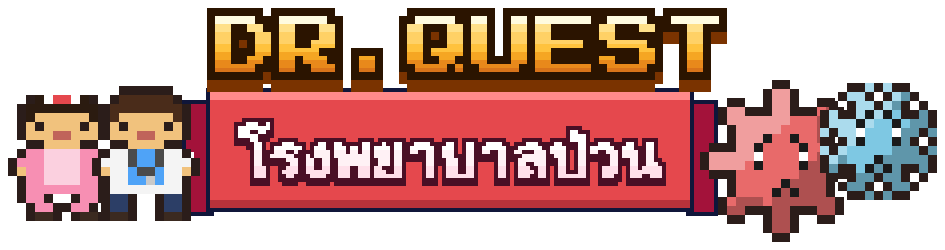

<p align="center"></p>

# Dr. Quest โรงพยาบาลป่วน 🏥

เกมไทคูนโรงพยาบาล 3D แนวไฮเปอร์แคชวล ใช้จอยเดินอย่างเดียว
เก็บยาจากเครื่องผลิต เอาไปวางเคาน์เตอร์ จ่ายยาให้คนไข้ เก็บเงิน แล้วขยายโรงพยาบาลให้ใหญ่ที่สุด

👉 **เล่นได้เลยที่ https://niasmin.github.io/Quest-Finance/** (เล่นบนมือถือได้ และกด "เพิ่มไปยังหน้าจอโฮม" เพื่อเปิดเต็มจอแบบแอป)

## วิธีเล่น

| ทำอะไร | ทำยังไง |
| --- | --- |
| เดิน | ลากนิ้วบนจอตรงไหนก็ได้ (คอมพิวเตอร์ใช้ WASD หรือลูกศร) |
| เก็บยา | เดินเข้าวงสีขาวหน้าเครื่องผลิต ยาจะซ้อนขึ้นหลัง |
| วางของ | เดินเข้าวงสีเหลืองหลังเคาน์เตอร์ |
| จ่ายยาให้คนไข้ | ยืนในวงสีเขียว (ช่องแคชเชียร์) จนกว่าจะจ้างพยาบาลมายืนแทน |
| เก็บเงิน | เดินผ่านกองธนบัตรสีเขียว |
| ปลดล็อก | ยืนบนช่องราคาสีดำ เงินจะไหลเข้าไปจนเต็ม |
| ทิ้งของ | เดินเข้าวงสีแดงที่ถังขยะ 🗑️ กลางทางเดิน ของที่แบกอยู่จะถูกทิ้งทั้งหมด (AUTO ทิ้งให้เองเมื่อแบกของที่ไม่มีที่วาง) |

ลูกศรสีเหลืองที่เท้าจะชี้ไปยังสิ่งที่ควรทำต่อเสมอ

ผู้เล่นใหม่มีบทสอน 6 ขั้นสั้น ๆ ปุ่มต่าง ๆ อยู่ที่แถบล่างจอ (🤖 AUTO · ⬆️ อัปเกรด · 📋 ภารกิจ · 🗺️ สาขา · ⚙️ เมนู) และจะโผล่ขึ้นมาพร้อมป้าย "ใหม่!" เมื่อถึงเวลาใช้ ปุ่มเสียงอยู่ในเมนู ⚙️

### ⬆️ อัปเกรด (อัปได้หลายเลเวล)

ปุ่ม ⬆️ มุมขวาบน (มีจุดแดงเมื่อมีเงินพอ): 👟 รองเท้าวิ่ง · 🎒 กระเป๋าใบใหญ่ · 👩‍⚕️ อบรมพนักงาน · ⚙️ เครื่องผลิตยา · 💰 ค่ารักษา · 📣 ประชาสัมพันธ์ ราคาสูงขึ้นทุกเลเวล เมื่อปลดล็อกครบทุกแผนก AUTO จะซื้ออัปเกรดที่ถูกที่สุดให้เอง

### 🧑‍🤝‍🧑 คนไข้หลายแบบ และ ⭐ ความพอใจ

| แบบ | จ่าย | ความอดทน |
| --- | --- | --- |
| ทั่วไป | ×1 | 60 วินาที |
| 🚨 ฉุกเฉิน (แซงคิว) | ×3 | 28 วินาที |
| 👑 VIP | ×5 | 45 วินาที |
| 👶 เด็ก (มีผู้ปกครองมาด้วย) | ×1.5 | 50 วินาที |

หลอดใต้ฟองคำพูดคือความอดทน ถ้าหมดคนไข้จะ 😡 เดินออกไม่จ่ายเงินและดาวลด บริการเร็วได้ทิป 💖 +20% และดาวเพิ่ม ดาวยิ่งสูงคนไข้ยิ่งมาเยอะ

### 📋 ภารกิจรายวัน และ 🏥 สาขาใหม่

- **ภารกิจรายวัน (ปุ่ม 📋):** มี 3 ภารกิจใหม่ทุกวัน เช่น รักษาคนไข้ ได้ทิป ช่วยคนไข้ฉุกเฉิน ทำครบกดรับเงินรางวัล
- **🗺️ เครือโรงพยาบาล:** สร้างสาขาล่าสุดครบทุกแผนกแล้วเปิดสาขาใหม่ได้ (ราคา 5,000 × จำนวนสาขา) สาขาใหม่รายได้ ×1.5, ×2.0, … สาขาเก่ายังอยู่ กลับไปเล่นได้ตลอด และหาเงินเข้ากระเป๋ากลางให้ตามพนักงานที่จ้างไว้ ใช้เงินกระเป๋าเดียวกันทุกสาขา แต่ละสาขามีแผนก อัปเกรด และดาวของตัวเอง

### ☁️ เซฟบนคลาวด์ (Supabase)

เกมสร้างกุญแจลับประจำเครื่องให้อัตโนมัติ ไม่ต้องสมัคร เซฟขึ้นคลาวด์ทุก 30 วินาทีและตอนปิดเกม เปิดเกมเมื่อไหร่จะดึงเซฟที่ใหม่กว่ามาให้ ย้ายเครื่องได้ด้วย **รหัสย้ายเครื่อง 8 ตัว** ในเมนู ⚙️ และมี 🏆 กระดานอันดับรายได้สะสม

ฝั่งฐานข้อมูลเก็บแค่ hash ของกุญแจ ตาราง `saves`/`save_keys` เปิด RLS โดยไม่มี policy เข้าถึงได้เฉพาะผ่านฟังก์ชัน `cloud_save`, `cloud_load`, `cloud_peek`, `cloud_claim` และ `leaderboard`

### 🏥 ผังโรงพยาบาล

แต่ละแผนกเป็นห้องมีผนังกั้น ประตูตรงกลาง พื้นสีของตัวเอง และป้ายหน้าห้อง ฝั่งขวาเป็นทางเดินกลางที่คนไข้เดินเข้าไปต่อคิว มีหมอกับพยาบาลเดินตรวจไปมา มี รปภ. เฝ้าทางเข้า และแม่บ้านคอยถูพื้นเมื่อมีน้ำหก

### 🎉 อีเวนต์ (เล่นด้วย AUTO ได้ทุกอย่าง)
- **🚨 ชั่วโมงเร่งด่วน** (ตั้งแต่เปิดห้องวัคซีน) — กดปุ่มมุมขวาบน คนไข้แห่มา 75 วินาที รายได้ ×1.5 จบแล้วได้ดาว 0–3 ดวงตามจำนวนคนที่รักษา และโบนัสก้อนใหญ่ กดใหม่ได้ทุก 4 นาที
- **🦠 เชื้อโรคยักษ์** (ตั้งแต่ขั้น 5) — โผล่ในห้องใดห้องหนึ่งเป็นระยะ ยืนใกล้ ๆ หมอจะยิงยาใส่เอง กำจัดใน 45 วินาทีได้เงินรางวัล และมีลุ้นของหายาก (ครั้งแรกได้แน่นอน) ถ้าปล่อยหนี ⭐ ลด ระหว่างนั้นคนไข้หมดความอดทนเร็วขึ้น
- **⭐ เคสพิเศษ** (ตั้งแต่ขั้น 3) — คนไข้เสื้อม่วงที่ต้องไปหลายห้องตามลำดับ เช่น 💉 → 🩻 → 🦷 รักษาครบทันเวลาได้ทิปก้อนใหญ่

### 🎨 ตกแต่งโรงพยาบาล
ซื้อด้วยกระเป๋าเงินเดียวกัน ใช้ได้ทุกสาขา
- **ของตกแต่ง** ต้นไม้ ภาพวาด แปลงดอกไม้ ตู้กดน้ำ ตู้ปลา น้ำพุ — เพิ่ม “ความสบาย” คนไข้รอได้นานขึ้น (+4%/แต้ม) และมาบ่อยขึ้น (+2%/แต้ม)
- **สีพื้นห้อง** พาสเทล · มิ้นต์ · พระอาทิตย์ตก · ทะเลสีคราม
- **ชุดหมอ** สครับเขียว สครับชมพู ชุดผ่าตัด หมอสุดเท่ (หมวกทรงสูง)
- **💎 ของหายากจากบอส** ชุดฮีโร่นักล่าเชื้อโรค (ยิงแรง ×2) · รูปปั้นเชื้อโรคทองคำ · พรมทางเดินสายรุ้ง · หมอมงกุฎทองคำ (รายได้ +10%)

### 🤖 เล่นอัตโนมัติ และรายได้ตอนไม่อยู่

- **AUTO (ปุ่ม 🤖 มุมขวาบน เปิดไว้ตั้งแต่แรก):** ถ้าไม่แตะจอ 2 วินาที หมอจะเล่นเอง เก็บยา วางเคาน์เตอร์ ยืนจ่ายยา เก็บเงิน และจ่ายปลดล็อกเมื่อเงินพอ แตะจอเมื่อไหร่ก็ควบคุมเองทันที ระหว่าง AUTO จอจะไม่ดับเอง (ถ้าเบราว์เซอร์รองรับ)
- **รายได้ตอนไม่อยู่:** ปิดเกมหรือสลับแอป พนักงานที่จ้างไว้ยังทำงานต่อ กลับมาจะได้เงินสะสม (35% ของรายได้ตอนเล่นจริง นับสูงสุด 6 ชั่วโมง) ไลน์ยาต้องมีทั้งพยาบาลแคชเชียร์และพยาบาลขนของ ห้องบริการต้องมีเจ้าหน้าที่ประจำห้อง

## ลำดับการขยายโรงพยาบาล

1. 👩‍⚕️ จ้างพยาบาลแคชเชียร์ — 60
2. 🎒 กระเป๋าใหญ่ขึ้น — 120
3. 💉 ห้องฉีดวัคซีน — 200
4. 👩‍⚕️ จ้างแคชเชียร์วัคซีน — 260
5. 🧑‍⚕️ จ้างพยาบาลขนยา — 350
6. ⚡ เครื่องผลิตเร็วขึ้น — 450
7. 🧑‍⚕️ จ้างพยาบาลขนวัคซีน — 550
8. 🩻 ห้องเอกซเรย์ — 800
9. 🧑‍🔬 จ้างนักรังสีเทคนิค — 900
10. 🎒 กระเป๋าใหญ่สุด — 1,000
11. 🚑 รถพยาบาลรับคนไข้ — 1,200
12. 🦷 ห้องทันตกรรม — 1,500
13. 🧑‍⚕️ จ้างทันตแพทย์ — 1,700
14. 🫀 ห้องผ่าตัด — 2,500
15. 🧑‍⚕️ จ้างศัลยแพทย์ — 2,800
16. 🪑 ห้องรอพร้อมเก้าอี้ — 3,200 (คิวเต็มเมื่อไหร่ คนไข้นั่งรอแทนการกลับบ้าน และความอดทนลดช้าลง)
17. 🛗 ลิฟต์ขึ้นชั้น 2 — 4,000
18. 🍲 โรงอาหารญาติคนไข้ (ชั้น 2) — 4,500
19. 👩‍🍳 จ้างแม่ครัว — 5,200
20. 🧑‍🍳 จ้างพนักงานเสิร์ฟ — 5,800
21. 🛏️ หอผู้ป่วยใน (ชั้น 2) — 6,500
22. 🛏️ เพิ่มเตียง 2 เตียง — 7,200
23. 👩‍⚕️ จ้างพยาบาลประจำหอ — 8,000
24. 🛏️ เพิ่มเตียงอีก 2 เตียง — 9,000 (ครบ 24 ข้อนี้ก็เปิดสาขาใหม่ได้)
25. 👁️ อาคารใหม่: ห้องตรวจตา — 10,000
26. 🧑‍⚕️ จ้างนักทัศนมาตร — 11,000
27. 🅿️ ลานจอดรถ — 12,000
28. 🦴 ห้องกายภาพบำบัด — 13,500
29. 🧑‍⚕️ จ้างนักกายภาพ — 15,000
30. 🏪 ร้านขายยาหน้า รพ. — 16,500
31. 🧑‍⚕️ จ้างเภสัชกรประจำร้าน — 18,000
32. 🩸 ห้องแล็บตรวจเลือด — 20,000
33. 🧑‍🔬 จ้างนักเทคนิคการแพทย์ — 22,000
34. 🌳 สวนพักฟื้น — 24,000
35. 🚁 ดาดฟ้า + ลานเฮลิคอปเตอร์ (ซื้อที่ชั้น 2) — 27,000
36. 🫁 ห้องไอซียู — 30,000
37. 🧑‍🚒 จ้างหน่วยกู้ชีพ — 33,000
38. 👩‍⚕️ จ้างพยาบาลไอซียู — 36,000
39. 🛏️ เพิ่มเตียงไอซียู — 40,000
40. 🧠 ชั้น 3: ห้องจิตวิทยา (ซื้อที่ชั้น 2) — 45,000
41. 🧑‍⚕️ จ้างนักจิตวิทยา — 50,000
42. 💆 ห้องนวดแผนไทย — 56,000
43. 🧑‍⚕️ จ้างหมอนวด — 62,000
44. 🥗 ห้องโภชนาการ — 70,000
45. 🧑‍⚕️ จ้างนักโภชนาการ — 78,000
46. 🤰 ชั้น 4: ห้องฝากครรภ์ (ซื้อที่ชั้น 3) — 90,000
47. 🧑‍⚕️ จ้างสูติแพทย์ — 100,000
48. 👶 ห้องคลอด — 115,000
49. 👩‍⚕️ จ้างพยาบาลผดุงครรภ์ — 130,000
50. 🍼 ห้องเด็กแรกเกิด — 150,000
51. 👩‍⚕️ จ้างพยาบาลเด็กแรกเกิด — 170,000

### 🌏 อาณาจักร: เมือง → จังหวัด → ภูมิภาค → ประเทศ → โลก
กดปุ่ม 🌏 อาณาจักร (แท็บแรกคือรายชื่อสาขาเหมือนเดิม)
- **🏙️ เมือง** 8 แปลงรอบโรงพยาบาล สร้างได้ 6 แบบ แต่ละแบบอัปได้ 3 เลเวล ช่วยทุกสาขา: 🏘️ หมู่บ้าน (คนไข้มา +4%) · 🏫 โรงเรียนแพทย์ (พนักงานไว +5%) · 🏭 โรงงานยา (ผลิตเร็ว +5%) · 🏦 ธนาคาร (รายได้ +4%) · 🏪 ตลาด (ภาษีต่อวินาที) · 🌳 สวนสาธารณะ (ความสบาย +2)
- **ยกระดับ** เมื่อสร้างครบ: 🏞️ จังหวัด (6 เมือง) → 🗾 ภูมิภาค (5 จังหวัด) → 🗺️ ประเทศ (6 ภาค) → 🌏 โลก (6 ทวีป) แต่ละที่บนแผนที่จ่ายภาษีทุกวินาที (ตอนไม่อยู่ก็ได้ 35%) และทุกระดับที่ขึ้นได้รายได้ทุกสาขา +10%
- ต้องมีสาขาเพิ่มตามระดับ: ภูมิภาค 2 สาขา · ประเทศ 3 สาขา · โลก 4 สาขา
- **เห็นของจริง:** 8 แปลงในเมืองเป็นตึก 3 มิติจริงฝั่งตะวันตกของโรงพยาบาล (เมืองหมอ) มีถนน ป้าย และชาวเมืองเดินไปมา กด "🚶 ไปดูเมืองจริง" หรือเดินออกประตูหน้าไปทางซ้าย ยืนในวงฟ้าหน้าแปลงเพื่อสร้าง/อัปเลเวล กด 🏥 มุมขวาบนเพื่อกลับ
- **ขยายเมือง:** ซื้อที่ดินเพิ่มได้ 4 ครั้ง ครั้งละ 4 แปลง (50,000 → 3,200,000) รวมสูงสุด 24 แปลง มีถนนสายที่สองเพิ่มให้
- **🔍 ซูมดูภาพรวม:** กดปุ่ม 🔍 มุมขวาบน หรือบีบสองนิ้ว (คอมใช้ลูกกลิ้งเมาส์) เพื่อซูมออกดูทั้งโรงพยาบาลและเมือง
- **🔭 แผนที่ 3 มิติ** ของจังหวัด ภูมิภาค ประเทศ (แต่ละภาคมีจุดเด่น เช่น ภูเขา นาข้าว วัด ชายหาด ช้าง ต้นมะพร้าว) และ **ลูกโลก** หมุนได้ เมืองโตตามเลเวล แตะที่บนแผนที่เพื่ออัปเกรดได้ทันที
- ตำแหน่ง: หมอประจำเมือง → หมอประจำจังหวัด → หมอใหญ่ประจำภาค → หมอแห่งชาติ → หมอแห่งโลก 🏆

### 🏆 อันดับ · ท้าทายวันนี้ · ห้องเพื่อน
- ใส่ชื่อหมอได้ตั้งแต่หน้าแรก ชื่อและตำแหน่งในอาณาจักร (เช่น 🌏 หมอแห่งโลก) โชว์ในตารางอันดับ
- อันดับรวมนับเฉพาะเงินจากคนไข้ **ไม่นับภาษีอาณาจักร**
- **📅 ท้าทายวันนี้** โจทย์เดียวกันทุกคน เปลี่ยนทุกเที่ยงคืน (ดูได้ในหน้าภารกิจ) มีตารางอันดับของวัน
- **👥 ห้องเพื่อน** สร้างห้องได้รหัส 5 ตัว ส่งให้เพื่อน จะเห็นอันดับเฉพาะคนในห้อง
- **⚡ โหมดประหยัด** (ในเมนู) ปิดเงาและลดของประกอบฉาก สำหรับมือถือรุ่นเก่า เกมจะแนะนำเองถ้าเฟรมเรตต่ำ

### 🗺️ แมพใหม่
- **อาคารใหม่ฝั่งตะวันออก** ประตูอยู่ที่ผนังทางเดิน มีห้องตรวจตา ห้องกายภาพ และห้องแล็บ (แบบเดียวกับห้องเอกซเรย์: ยืนในวงเขียวหรือจ้างเจ้าหน้าที่)
- **ฝั่งตรงข้ามถนน** 🅿️ ลานจอดรถ (รถมาจอดจ่ายค่าจอด + คนไข้มาเพิ่ม 15%) · 🏪 ร้านขายยา (คนเดินผ่านแวะซื้อ ยืนขายเองหรือจ้างเภสัชกร) · 🌳 สวนพักฟื้น (คนไข้ที่หายแล้วแวะนั่งพักและหยอดกล่องบริจาค + ความสบาย +4)
- **ดาดฟ้า (ชั้น 3)** เฮลิคอปเตอร์ส่งเคสฉุกเฉินมาเรื่อย ๆ ยืนวงส้มเพื่อเข็นเปลเข้าไอซียู แล้วยืนที่เคาน์เตอร์พยาบาลเพื่อดูแลจนหาย ได้เงินก้อนใหญ่ (ส่งลงตะกร้าเชือกเหมือนชั้น 2) ลิฟต์มีหลายชั้น (ชั้น 1–4 และดาดฟ้า): ยืนบนลิฟต์แล้วกดเลือกชั้น
- **ชั้น 3 คลินิกเฉพาะทาง** 🧠 จิตวิทยา · 💆 นวดแผนไทย · 🥗 โภชนาการ และ **ชั้น 4 แม่และเด็ก** 🤰 ฝากครรภ์ · 👶 ห้องคลอด · 🍼 เด็กแรกเกิด คนไข้ขึ้นลิฟต์มาเอง ยืนในวงเขียวหรือจ้างเจ้าหน้าที่ เงินส่งลงตะกร้าเชือก
- **สาขาธีมใหม่** แต่ละสาขาอยู่คนละที่: 🏙️ ในเมือง · 🏖️ ริมทะเล · ❄️ บนเขาหิมะ (หิมะตก) · 🌴 กลางป่า (ฝนตก) · 🌃 เมืองยามค่ำ · 🏜️ ทะเลทราย และมีคนไข้เฉพาะถิ่น เช่น 🪼 โดนแมงกะพรุน 🥶 หนาวสั่น 🐍 งูกัด (จ่ายเงิน ×2)

### 🏢 ชั้น 2

ยืนบนแท่นลิฟต์ 🛗 ที่ทางเดินกลาง (ใกล้ทางเข้า) แล้วลิฟต์จะพาขึ้นลง ทั้งสองชั้นทำงานพร้อมกันตลอด
- **🍲 โรงอาหารญาติคนไข้:** เก็บวัตถุดิบ → ใส่หม้อต้มยักษ์ → ได้ข้าวต้ม → วางเคาน์เตอร์ → ยืนวงเขียวเสิร์ฟให้ญาติบนอัฒจันทร์ (ฟองคำพูดบอกจำนวน รอนานจะ 😡)
- **🛏️ หอผู้ป่วยใน:** คนไข้นอนพักจ่ายเงินตลอดเวลาที่น้ำเกลือยังหยด เอาถุงน้ำเกลือ 💧 ไปเปลี่ยนที่วงฟ้าข้างเตียง
- **🧺 ตะกร้าเงิน:** รายได้ชั้น 2 ลงตะกร้าห้อยเชือก หย่อนลงไปกองหน้าโรงพยาบาลชั้นล่างให้เก็บ
- ชั้น 2 มีถังขยะของตัวเอง และ AUTO ขึ้นลงลิฟต์เองเมื่อมีงานอีกชั้น

ความคืบหน้าบันทึกในเบราว์เซอร์อัตโนมัติทุก 5 วินาที (ขึ้น 💾 บันทึกแล้ว) เมนู ⚙️ มีปุ่มบันทึกตอนนี้ คัดลอก/ใส่โค้ดเซฟสำหรับย้ายเครื่อง และเริ่มใหม่

> เบราว์เซอร์ในแอป (เช่นกดลิงก์จาก LINE หรือแอปอื่น) และโหมดส่วนตัวมักไม่เก็บข้อมูล ให้เปิดใน Safari/Chrome หรือเก็บโค้ดเซฟไว้ ส่วนไอคอนบนหน้าจอโฮมของ iPhone มีที่เก็บเซฟแยกจาก Safari มีเพลงประกอบแนวชิปทูน เปิดหรือปิดเสียงได้ที่ปุ่ม 🔊

## รันบนเครื่องตัวเอง

```bash
npm start
```

แล้วเปิด http://localhost:3000 (ไม่ต้อง `npm install` เพราะไม่มี dependency)

## โครงสร้าง

```
public/index.html         หน้าเกม, HUD, หน้าเริ่ม
public/game.js            ตัวเกมทั้งหมด (three.js): ฉาก ตัวละคร คนไข้ พนักงาน การปลดล็อก เซฟ
public/vendor/            three.js r160 (MIT) ฝังไว้ในโปรเจกต์
server.js                 เซิร์ฟเวอร์ไฟล์สำหรับรันในเครื่อง
tools/logo.html           สร้างโลโก้ ไอคอน และภาพแชร์ลิงก์ (รันใหม่ด้วย node tools/render-logo.js ต้องมี Playwright)
.github/workflows/pages.yml  deploy โฟลเดอร์ public/ ขึ้น GitHub Pages เมื่อ push เข้า main
```

ปรับราคา ลำดับปลดล็อก หรือตำแหน่งต่าง ๆ ได้ที่ส่วน `data` ด้านบนของ `public/game.js`

เกม RPG พิกเซลเวอร์ชันก่อนหน้ายังอยู่ในประวัติ git (ก่อน commit ที่เปลี่ยนเป็นไทคูน)
